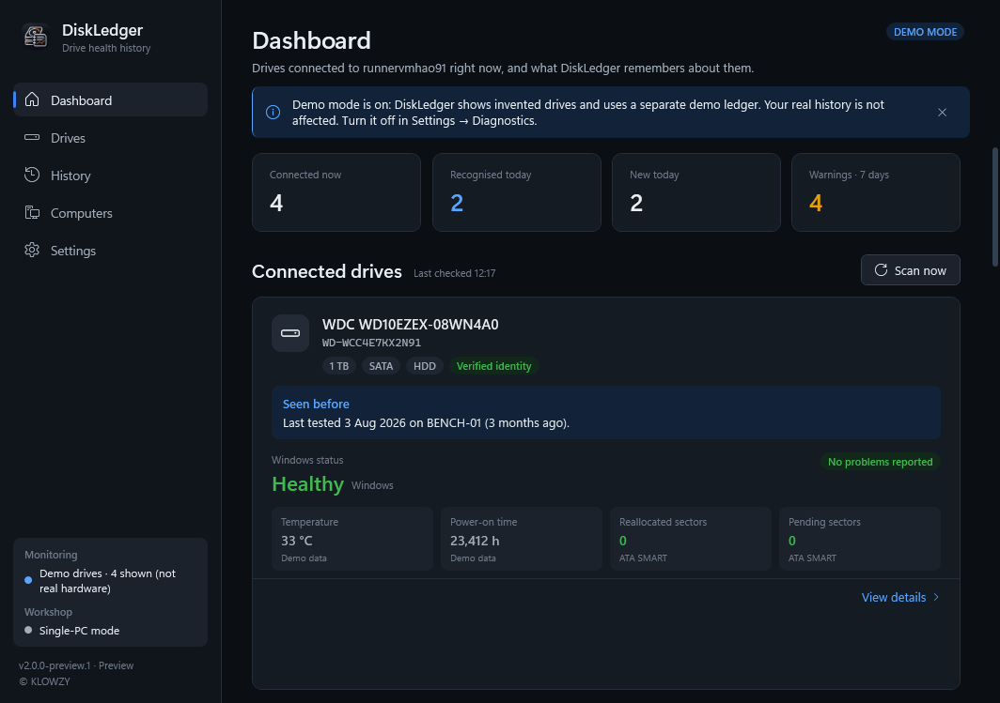

  

<h1 align="center">DiskLedger</h1>

  <strong>Recognise every drive you have tested before — and see what changed.</strong> 
  Drive health history for Windows repair and refurbishing workshops · Published by <strong>KLOWZY</strong>

  
  
  
  

  <a href="https://github.com/KlowzyZ/DiskLedger/releases/download/v2.0.0-preview.1/DiskLedger-v2.0.0-preview.1-win-x64-Setup.exe"><strong>Download installer</strong></a>
  &nbsp;·&nbsp;
  <a href="https://github.com/KlowzyZ/DiskLedger/releases/download/v2.0.0-preview.1/DiskLedger-v2.0.0-preview.1-win-x64-Portable.zip"><strong>Download portable ZIP</strong></a>
  &nbsp;·&nbsp;
  <a href="https://github.com/KlowzyZ/DiskLedger/releases/tag/v2.0.0-preview.1">Release notes</a>
  &nbsp;·&nbsp;
  <a href="https://klowzy.com/diskledger">klowzy.com/diskledger</a>

> [!IMPORTANT]
> **v2.0.0-preview.1 is a preview.** It has been built and tested automatically on Windows, but it has **not yet been verified on real workshop hardware** (physical HDDs, SSDs, NVMe drives and USB adapters). Please report anything unexpected.

---

## What is DiskLedger?

Connect a drive — by SATA, NVMe or USB — and DiskLedger tells you straight away whether it has been tested before: **when, on which computer, and what has changed since**. Every connection is recorded automatically into a long-term history that you can search by any part of the serial number.

DiskLedger 2 is **one Windows application**. There is no server to set up, no database to install, no .NET runtime to download and no scripts to run. Install it and it starts working.

## Highlights

| | |
|---|---|
| **Works on a single PC out of the box** | History is stored on the computer. No server, no network, no account. |
| **Reads drives directly through Windows** | Model, serial number, capacity, interface, HDD/SSD/NVMe type and Windows' own health status — without any other software. |
| **Detailed SMART data** | Reallocated, pending and uncorrectable sectors, power-on time, temperature, NVMe wear, spare and media errors — read after *Restart with full access* (Windows asks for permission). |
| **Honest readings** | Every value shows where it came from. Anything a drive or adapter cannot report is shown as *Unavailable* with the reason — never as zero, never invented. DiskLedger does not make up a health score. |
| **History that answers questions** | One record per drive per day, with important changes (falling health, new bad sectors, rising wear) kept as events. Trend charts, timeline and technician notes per drive. |
| **Careful identity** | Drives are recognised by serial number, with model and capacity checks for USB adapters. Drives with missing or placeholder serials are never mixed up with other drives. |
| **Optional Hard Disk Sentinel** | If Hard Disk Sentinel Professional is running with WMI enabled, its health percentage is recorded too, clearly labelled as Sentinel's. Not required. |
| **Optional workshop mode** | Several PCs can share one history over your local network: encrypted, paired with a one-time setup code; every PC keeps working offline and catches up later. |
| **Safe by design** | Read-only towards drives — DiskLedger never formats, erases, resets or writes to a disk. Automatic daily backups, CSV and JSON export. |
| **Private** | No accounts, advertising or analytics. The only default outbound request is a daily check of this repository's releases (can be turned off). |
| **Languages** | English, Türkçe, العربية (right-to-left). |

## Download and install

| File | What it is |
|---|---|
| [**DiskLedger-v2.0.0-preview.1-win-x64-Setup.exe**](https://github.com/KlowzyZ/DiskLedger/releases/download/v2.0.0-preview.1/DiskLedger-v2.0.0-preview.1-win-x64-Setup.exe) | Recommended. Installs for the current user — **no administrator rights needed**. Start menu entry, optional start at sign-in, uninstaller. |
| [**DiskLedger-v2.0.0-preview.1-win-x64-Portable.zip**](https://github.com/KlowzyZ/DiskLedger/releases/download/v2.0.0-preview.1/DiskLedger-v2.0.0-preview.1-win-x64-Portable.zip) | No installation. Unzip and run `DiskLedger.exe`; history is stored in a `Data` folder next to it. |
| [SHA256SUMS.txt](https://github.com/KlowzyZ/DiskLedger/releases/download/v2.0.0-preview.1/SHA256SUMS.txt) | Checksums. Verify with `Get-FileHash <file> -Algorithm SHA256`. |

**Requirements:** Windows 10 (1809 or later) or Windows 11, 64-bit. Nothing else.

The binaries are **not code-signed** yet, so Windows SmartScreen may show "Windows protected your PC". Choose *More info → Run anyway* only if the file came from this page and its checksum matches.

Uninstalling keeps your drive history unless you choose to delete it. Upgrading keeps history and settings.

**Upgrading from 0.1:** the old Agent, Server and Desktop are replaced by the single app. On first start, DiskLedger 2 imports the 0.1 history automatically; the original files are left untouched and a copy is kept in the Backups folder. The old 0.1 Windows services can be removed afterwards.

## How it works

1. **Connect a drive.** DiskLedger notices it within seconds — including blank and unformatted disks.
2. **It identifies the drive** by serial number (and checks model and capacity when the drive is behind a USB adapter).
3. **It tells you what it knows:** *Seen before — last tested 12 Mar 2026 on BENCH-02 (92 days ago)*, or *New drive*.
4. **It records today's readings** and highlights anything that changed since the previous test.
5. **Months later, on any workshop PC** (in workshop mode), the drive is recognised again.

## Screenshots

More in [screenshots/](screenshots/). All screenshots are captured automatically on Windows with DiskLedger's built-in **demo mode** (invented drives in a separate demo ledger) — not from real hardware.

## Known limitations of this preview

- **Not yet verified on physical workshop hardware.** Automated tests use synthetic drive data and a Windows virtual machine.
- **SMART through USB depends on the adapter.** Many low-cost adapters cannot pass SMART commands; DiskLedger then shows the measurement as *Unavailable* with an explanation. Identity through such adapters may be temporary.
- **SAS drives:** health via SCSI log pages is not read yet.
- **Full SMART data needs administrator approval** ("Restart with full access"). Without it, drives are still detected, recognised and recorded with Windows' health status.
- **No Windows service:** monitoring runs while DiskLedger is running (it starts in the notification area at sign-in if you chose that during installation).
- **Turkish and Arabic** translations are awaiting native-speaker review.
- **Hard Disk Sentinel integration** reads Sentinel's WMI interface; property names may differ between Sentinel versions. *Settings → Data sources* shows what was found.

Troubleshooting: run `DiskLedger.exe --probe report.json` to create a read-only hardware report, and attach it (plus `%LocalAppData%\DiskLedger\Logs`) to an [issue](https://github.com/KlowzyZ/DiskLedger/issues).

## Privacy and network

No account, no cloud, no telemetry. Outbound connections: a release check against this repository at most once a day (turn off in *Settings → Updates*), and — only if you enable workshop mode — your own workshop computers over an encrypted, paired connection on your local network. See the [Security Policy](SECURITY.md).

## Hard Disk Sentinel disclaimer

DiskLedger is independent software by **KLOWZY** and is not affiliated with or endorsed by Hard Disk Sentinel. Hard Disk Sentinel is not included and not required. Product names and trademarks belong to their respective owners.

## License

DiskLedger is proprietary software — see [LICENSE.txt](LICENSE.txt). Third-party components: [THIRD-PARTY-NOTICES.txt](THIRD-PARTY-NOTICES.txt).

Copyright © 2026 KLOWZY. All rights reserved.

## Support

Found a problem? [Open an issue](https://github.com/KlowzyZ/DiskLedger/issues) with your Windows version, the drive and adapter used, and the `--probe` report if possible.
